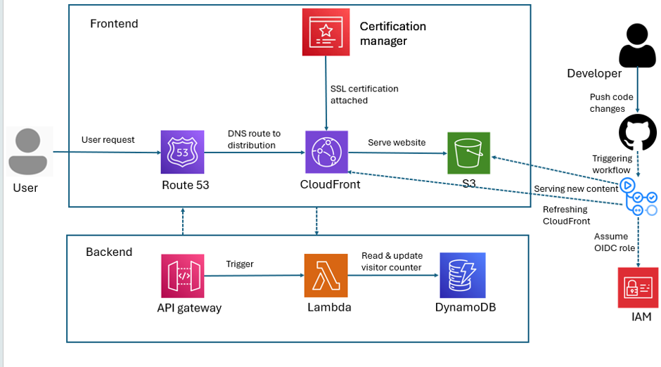

# Cloud Resume Challenge
This is my take on the Cloud Resume Challenge.

The Cloud Resume Challenge is a hands-on project designed to demonstrate cloud computing skills by building and deploying a personal resume website using AWS services. 

[Check out my live website here!](https://muhammad-cloud-resume-challenge.com/)


## Architecture



## Repository layout

```text
.
├── .github/
│   └── workflows/
│       └── main.yml                  # deploys the site on push to main
├── terraform/
│   ├── assets/                       # HTML, CSS, and image files for the resume site
│   ├── lambda/
│   │   ├── func.py                   # Lambda function that increments the visitor count
│   │   └── func.zip                  # generated deployment artifact
│   ├── api-gateway.tf                # HTTP API and route configuration
│   ├── cert.tf                       # certificate resources
│   ├── cloudfront.tf                 # CDN configuration and security headers
│   ├── dynamodb.tf                   # visitor counter table
│   ├── lambda.tf                     # IAM + Lambda function setup
│   ├── main.tf                       # Terraform provider configuration
│   ├── outputs.tf                    # useful deployment outputs
│   ├── route53.tf                    # DNS records
│   ├── s3.tf                         # static site bucket and object uploads
│   ├── terraform.tf                  # Terraform backend settings
│   ├── variables.tf                  # environment and naming defaults
│   └── .terraform.lock.hcl           # pinned provider versions
├── .gitignore
├── README.md
└── .terraform/                      # local Terraform state/cache (generated)
```

## Prerequisites

Before deploying this project, make sure you have:

- An AWS account with permissions to create:
  - S3 buckets
  - CloudFront distributions
  - Route53 records
  - API Gateway
  - Lambda functions
  - DynamoDB tables
  - ACM certificates
- Terraform installed locally
- AWS CLI configured with credentials or OIDC-based GitHub deployment access
- A domain name and hosted zone for the production site 

## Configuration

The main settings are defined in `terraform/variables.tf`.

Update the defaults for:

- `domain_name`
- `bucket_name`
- `region`
- `environment_name`

These values control the website domain, the S3 bucket name, and the deployment region.

## Deployment

### Local deployment with Terraform

```bash
cd terraform
terraform init
terraform plan
terraform apply
```

This creates the AWS resources needed for the website, API, and visitor counter.

### GitHub Actions deployment

The workflow in `.github/workflows/main.yml` deploys the website when changes are pushed to `main`.

It performs the following:

1. Authenticates to AWS using OIDC
2. Runs Terraform to read the output values
3. Copies the site files from `terraform/assets`
4. Injects the API URL into each page
5. Uploads the static site to S3
6. Invalidates the CloudFront cache

## Customizing the site

The content is in `terraform/assets/`.

You can update:

- `index.html` for the main profile/home page
- `skills.html` for skills and experience sections
- `contact.html` for contact information
- `image.png` for your profile image

The portfolio site also dynamically inserts the API URL into each page so the visitor counter works in production.

## Notes

- The visitor counter is intentionally lightweight and serverless.
- CloudFront is fronted by S3 via Origin Access Control (OAC) for secure content delivery.
- Security headers are enabled through the managed CloudFront response policy.
- The Lambda function increments the `visits` value in the DynamoDB table keyed by `id = visitors`.


## Project status
This repository is set up as a working cloud resume project and is ready for AWS deployment and customisation.
